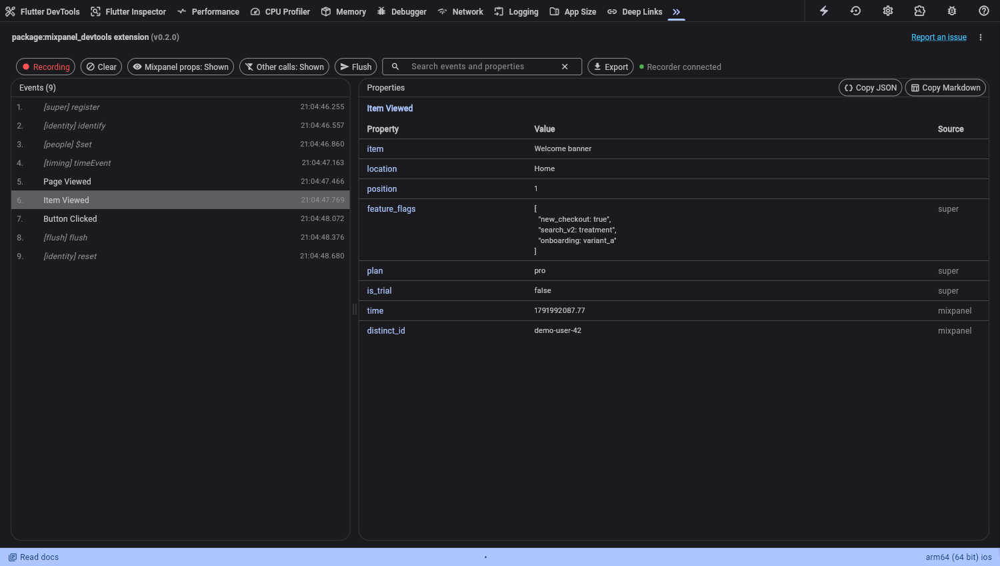

# mixpanel_devtools

A Flutter DevTools extension that shows the Mixpanel calls of a running app. You can inspect,
search, and export the calls. It works like the Chrome "Mixpanel Tools" extension, but for
Flutter apps on iOS and Android.



Use it when you must check that the app sends the correct events with the correct properties,
but you cannot open the Mixpanel project (for example, because access to it is restricted).

## Features

| Feature | Description |
|---|---|
| Live event list | Each `track`, people, identity, super-property, timing, consent, flush, and group call, numbered, with the local time |
| Property table | The event properties, the super properties sent with the event, and `time` / `distinct_id`. Each row shows its source |
| Mixpanel props: Hidden / Shown | Hides or shows `time`, `distinct_id`, and keys that start with `$` or `mp_` |
| Other calls: Shown / Hidden | Hides people, identity, super-property, timing, consent, flush, and group calls, so the list shows only `track` events. The numbers stay in sequence |
| Recording / Paused | Pauses the list without changing the app |
| Search | Matches event names, kinds, property keys, and property values |
| Flush | Asks the app to send its queued events to Mixpanel now |
| Export | Download JSON, CSV (one row per event), or Markdown. Copy one event or all events as Markdown for a wiki page or an issue |
| History | Shows events that fired before you opened DevTools. Keeps the events of earlier runs after a hot restart, until you press Clear |

## Why the app needs a recorder

`mixpanel_flutter` sends each call over a platform channel to the native iOS or Android SDK.
The native SDK sends the HTTP requests, in batches. DevTools cannot see that traffic, so the
DevTools Network tab cannot help here.

Thus the app sends each call to the tab itself, through `dart:developer`. The recorder that does
this is one file that you copy into the app. It has no dependency on this package, so this
package stays a `dev_dependency`.

## Setup

1. Add the package as a dev dependency:

   ```bash
   flutter pub add --dev mixpanel_devtools
   ```

   Or add it to `pubspec.yaml` yourself:

   ```yaml
   dev_dependencies:
     mixpanel_devtools: ^0.2.0
   ```

2. Enable the extension in `devtools_options.yaml`, next to `pubspec.yaml`:

   ```yaml
   extensions:
     - mixpanel_devtools: true
   ```

3. Copy [`example/lib/mixpanel_devtools_recorder.dart`](example/lib/mixpanel_devtools_recorder.dart)
   into the app.

4. Wrap the instance that `Mixpanel.init` returns, and use the result everywhere:

   ```dart
   final mixpanel = await Mixpanel.init(token, trackAutomaticEvents: true);
   final recorded = MixpanelDevtoolsRecorder.instrument(mixpanel, token: token);
   ```

   In release builds, `instrument` returns `mixpanel` unchanged and records nothing.

5. Run the app in debug or profile mode. Open DevTools, then open the **mixpanel_devtools** tab.

## Try it with the demo app

```bash
cd example
flutter run --dart-define=AUTOPLAY=true
```

The demo sends one call of each kind at start-up. Without `--dart-define=MIXPANEL_TOKEN=...` it
opts out of tracking, so the native SDK sends nothing to Mixpanel.

## Limits

- The tab shows what the app passes to the SDK, plus the super properties and the distinct id
  that the recorder knows. It does not show the properties that the native SDK adds later, such
  as `$os` and `$model`.
- The tab cannot confirm that Mixpanel accepted a batch.
- The recorder sees super properties that the app registers after `instrument`. It reads the
  earlier ones from the SDK once, at start-up.
- Group profile calls (`getGroup(...).set(...)`) and feature-flag calls are not recorded.

## Privacy

Everything stays on your computer: the app, the DevTools page, and the files that you export.
The tab saves the most recent 1000 records in the browser `sessionStorage` of the DevTools tab,
and the two display modes in `localStorage`.
The exports can contain personal data from the test account. Do not share them outside the team.

## Protocol

The tab and the recorder share a small protocol: one `Extension` stream event per call
(`mixpanel_devtools:record`), and three service extensions
(`ext.mixpanel_devtools.getRecords`, `.clear`, `.flush`). See the
[design document](doc/specs/2026-10-08-mixpanel-devtools-design.md) for the record format.

## Development

```bash
flutter test                         # extension tests
(cd example && flutter test)         # recorder tests
dart run devtools_extensions build_and_copy --source=. --dest=extension/devtools
dart run devtools_extensions validate --package=.
```

Build and copy again after each change to `lib/`. DevTools loads the extension from
`extension/devtools/build`.
